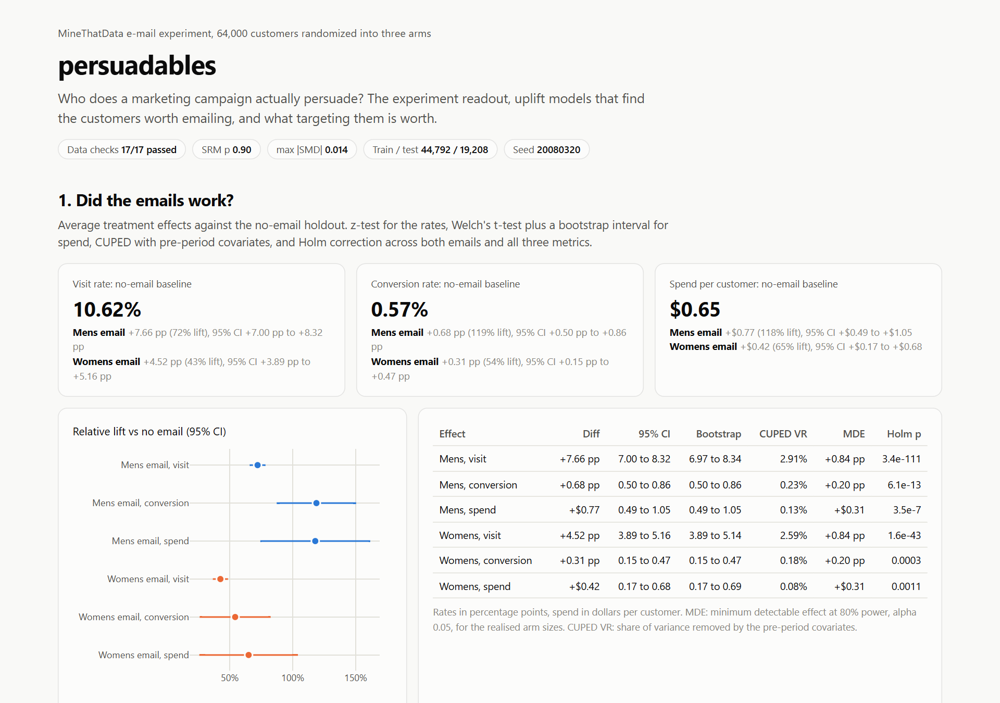
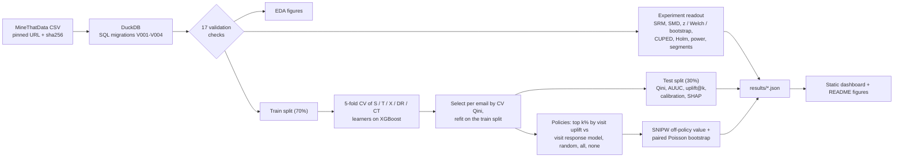
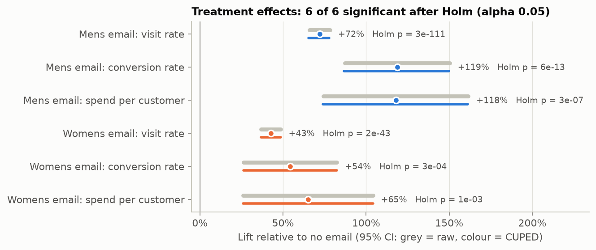
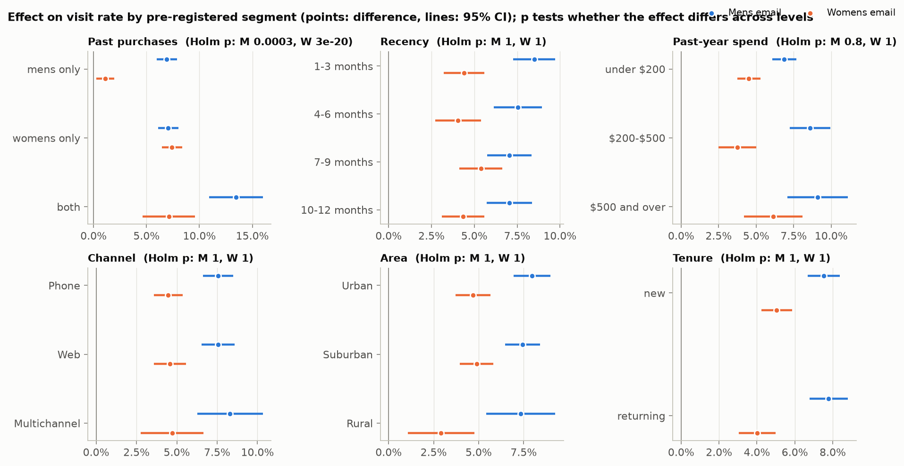
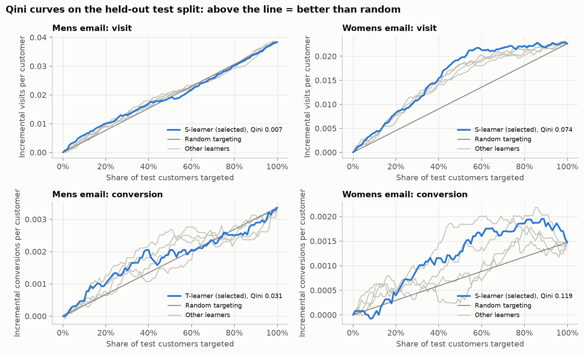
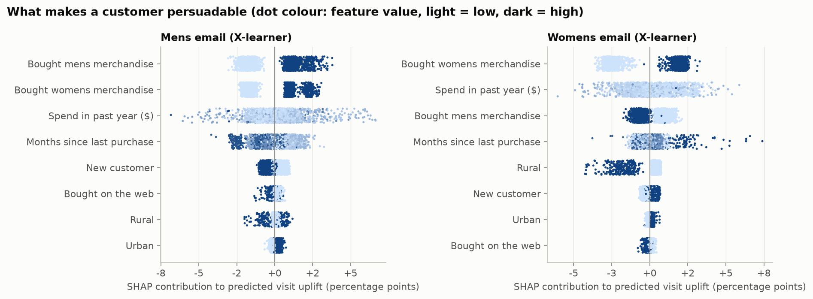
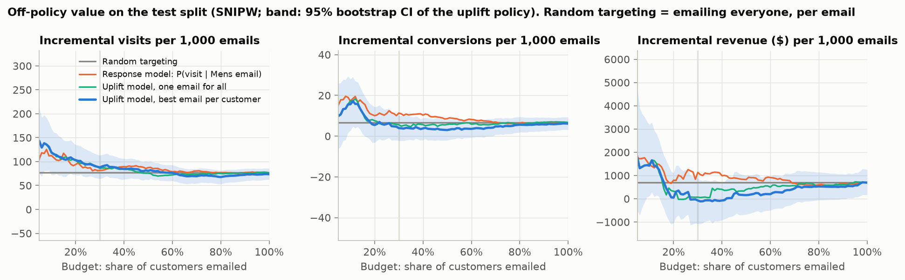
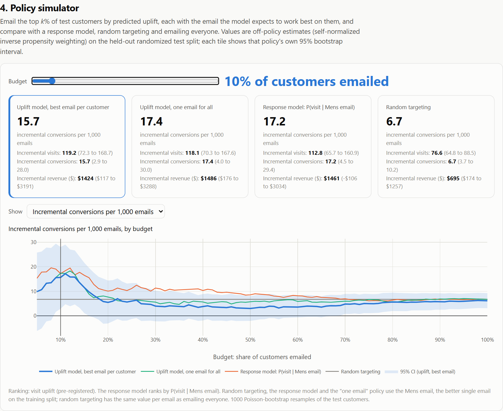

<div align="center">

# persuadables

**Who does a marketing campaign actually persuade?** A/B testing done properly, then uplift
models that find the customers worth targeting, then an honest estimate of what targeting them
is worth.

[](https://github.com/aamodbhatt/persuadables/actions/workflows/ci.yml)
[](LICENSE)




<sub>The static dashboard written by <code>persuadables report</code>, captured with Playwright in
Edge (<code>scripts/capture_screenshots.py</code>). Every number on it comes from
<code>results/*.json</code>.</sub>

</div>

## Why

An email "works" if the people who got it bought more than the people who did not. That is the
average effect, and it is the easy part. The money is in the next two questions: **who** did it
persuade, and **what is it worth** to email only them? Most targeting in practice ranks customers
by how likely they are to respond, which mixes up "would have responded anyway" with "responded
because of the email". This project answers all three questions on a real randomized experiment,
with the statistics a data-science screen asks for and an off-policy evaluation that puts a
confidence interval on every claim, and it tests that classic response ranking against uplift
ranking instead of assuming the response ranking loses.

## What it does

- **SQL feature pipeline.** Versioned DuckDB migrations (`V001` to `V004`) build typed tables, the
  pre-registered segments and a seeded, stratified train/test split from the raw CSV (pinned URL
  and sha256). Each run records the sha256 of every SQL file it applied.
- **Data validation.** 17 checks: schema, row count, nulls, ranges, logical consistency
  (a conversion implies a visit, spend is positive exactly when a customer converted), the split,
  sample-ratio mismatch and covariate balance. The pipeline stops on any failure.
- **Experiment readout.** SRM chi-square test; standardized mean differences; two-proportion
  z-tests (visit, conversion); Welch's t-test plus a stratified bootstrap interval (spend);
  CUPED with nine pre-period covariates and the variance reduction it achieved; Holm correction
  across both emails and all three metrics; power and minimum detectable effects; effects within
  six pre-registered segments with Cochran's Q heterogeneity tests, Holm-corrected.
- **Uplift models.** S-, T-, X- and DR-learners and a class-transformation baseline, all on
  XGBoost (CPU, 4 threads), chosen per email by 5-fold stratified cross-validation on the training
  split. Scored once on the held-out split: Qini and uplift curves, the Qini coefficient with a
  bootstrap interval, AUUC, uplift@k, calibration by decile, and exact TreeSHAP attributions of
  the predicted uplift.
- **Validated on known effects.** On synthetic randomized data with a planted heterogeneous
  effect, every learner must recover the effect ranking (tested; results below).
- **Decision layer.** Budget-constrained targeting (email the top k% by predicted visit uplift,
  each with the email the model expects to work best) valued by inverse propensity weighting on
  the randomized test split, against emailing everyone, no one, a random k% and the top k% of a
  response model on the same outcome, P(visit | Mens email). Every value is stated per 1,000
  emails with a bootstrap interval; differences between policies get paired intervals.
- **Dashboard.** One static HTML file (Plotly, works offline): readout, segments, Qini curves,
  calibration, SHAP and a policy simulator with a budget slider.
- **Typed CLI**: `persuadables data | analyze | train | evaluate | report | all`. Seeded and
  deterministic: rerunning a stage reproduces `results/*.json` byte for byte (tested).

## Quickstart

Needs [uv](https://docs.astral.sh/uv/). The full pipeline takes about a minute on a laptop CPU and
downloads one 4 MB file.

**Windows (PowerShell)**

```powershell
git clone https://github.com/aamodbhatt/persuadables; cd persuadables
uv sync
uv run persuadables all
start reports\dashboard.html
```

**macOS / Linux**

```bash
git clone https://github.com/aamodbhatt/persuadables && cd persuadables
uv sync
uv run persuadables all
open reports/dashboard.html        # xdg-open on Linux
```

Linux and Windows install the CPU-only `xgboost-cpu` wheel; macOS installs the regular `xgboost`
wheel (CPU-only on macOS). If XGBoost on macOS reports a missing OpenMP library, run
`brew install libomp`.

**Docker** (Linux or macOS shell; the output folders are created first so they belong to you)

```bash
docker build -t persuadables .
mkdir -p data results reports docs/assets
docker run --rm --user "$(id -u):$(id -g)" \
  -v "$PWD/data:/app/data" -v "$PWD/results:/app/results" \
  -v "$PWD/docs/assets:/app/docs/assets" -v "$PWD/reports:/app/reports" persuadables all
```

Each stage also runs alone (`uv run persuadables train`, ...), reading the previous stage's
outputs. `--config` takes another TOML file; `configs/default.toml` produced every number below.

## How it works



The parts worth a closer look:

- **The test split is a fresh experiment.** Randomization makes the held-out 30% a small A/B test of
  its own, so a policy's value can be estimated without deploying it: a customer whose random arm
  matches what the policy would have sent stands in for everyone the policy treats that way,
  reweighted by 1 / P(arm) (`policy/ope.py`). Self-normalized IPW is the headline estimator; the
  unnormalized one is stored next to it as a check. Every policy and outcome is valued on the same
  Poisson-bootstrap resamples, so differences between policies get paired intervals.
- **Policies are probability matrices.** "Email the top 30% with their best email" and "email a
  random 30%" are both an (n customers x 3 arms) matrix of action probabilities, so one estimator
  values deterministic and stochastic policies alike (`policy/policies.py`).
- **SHAP of the uplift, not of a response.** The X- and DR-learners end in regression trees that
  predict the uplift itself, so XGBoost's exact TreeSHAP attributes the uplift directly. For the
  X-learner, whose output is a fixed blend of two models, the blend of their SHAP values is the
  SHAP value of the blend; a test checks that each row sums to the prediction.
- **Selection never sees the test split.** Learners are chosen by 5-fold CV on the training split;
  the test split is touched once, for the numbers below. The ranking outcome (visit), the headline
  budget (30%), the segments and the CUPED covariates were fixed in the config and SQL before the
  readout, training or evaluation stages were first run.
- **Every statistic has a reference.** z-test vs statsmodels, Welch vs scipy, bootstrap vs
  `scipy.stats.bootstrap`, SRM vs `scipy.stats.chisquare`, Holm vs `multipletests`, power and MDE
  vs `NormalIndPower`, Cochran's Q vs `combine_effects`, CUPED vs an OLS regression adjustment,
  calibration slope vs WLS, Qini and uplift curves vs a brute-force definition.

## Results

Kevin Hillstrom's MineThatData E-Mail Analytics experiment: 64,000 customers who bought in the
past year, randomized into a Mens email, a Womens email or no email (21,307 / 21,387 / 21,306),
with visits, conversions and spend in the following two weeks. All runs on a laptop CPU (Intel
Core Ultra 9 275HX), thread pools capped at 4, no GPU: the whole pipeline takes **under a minute**
(49 s for a clean rebuild from the cached CSV; training is 27-32 s for 100 cross-validation fits
and 20 final fits) and peaks at a **0.67 GB** working set (the evaluate stage).
Every statistic, count and model score below is in `results/`; the run times and memory were
measured on this machine and are not.

### 1. The experiment is sound, and both emails work

All 17 data checks pass. Arm sizes match the design (SRM chi-square p = 0.90) and the largest
standardized mean difference across 11 covariates is 0.014.



| vs no email | Visit rate | Conversion rate | Spend per customer |
|---|---|---|---|
| No email (baseline) | 10.62% | 0.573% | $0.65 |
| Mens email | **+7.66 pp** [7.00, 8.32] | **+0.68 pp** [0.50, 0.86] | **+$0.77** [0.49, 1.05] |
| Womens email | **+4.52 pp** [3.89, 5.16] | **+0.31 pp** [0.15, 0.47] | **+$0.42** [0.17, 0.68] |

95% intervals. All six effects stay significant after Holm correction (largest adjusted
p = 0.0011). For spend, 99.1% zeros, the stratified bootstrap interval agrees with Welch's to the
cent (Mens: [$0.49, $1.05] both ways).

**Power and CUPED.** With ~21,300 customers per arm the test could detect a 0.84 pp change in visit
rate (7.9% relative) but only a 36% relative change in conversion and a 48% change in spend
(80% power, alpha 0.05). It had 94% power for a 10% visit lift but only 12% for a 10% conversion
lift, which would need 272,575 customers per arm.
CUPED with nine pre-period covariates removed only **2.9%** of visit variance and under 0.25% for
conversion and spend: purchase history barely predicts the next two weeks, so CUPED cannot rescue
the conversion test here.

### 2. Who responds: the Womens email persuades womens-merchandise buyers



| Visit effect | Mens email | Womens email |
|---|---|---|
| Bought only mens merchandise | +6.92 pp [5.96, 7.88] | **+1.11 pp** [0.24, 1.97] |
| Bought only womens merchandise | +7.06 pp [6.11, 8.01] | **+7.40 pp** [6.44, 8.35] |
| Bought both | +13.44 pp [10.91, 15.98] | +7.11 pp [4.65, 9.57] |
| Heterogeneity (Cochran's Q, Holm p) | Q = 23.2, p = 3.1e-4 | Q = 97.3, p = 2.6e-20 |

Of 36 pre-registered heterogeneity tests (6 segments x 2 emails x 3 metrics), three survive Holm:
past purchase category for both emails on visits, and past-year spend tier for the Womens email on
conversion (p = 0.042). Recency, channel, area and tenure show no detectable heterogeneity.

### 3. A model can find the persuadables, for one email



| Test split (CV-selected learner) | Qini coefficient [95% CI] | Uplift in top 10% | Calibration slope |
|---|---|---|---|
| Womens email, visit (S-learner) | **0.074** [0.050, 0.111] | +8.0 pp | 1.18 |
| Mens email, visit (S-learner) | 0.007 [-0.018, 0.033] | +12.1 pp | 0.20 |
| Womens email, conversion (S-learner) | 0.119 [-0.004, 0.239] | +0.01 pp | 0.83 |
| Mens email, conversion (T-learner) | 0.031 [-0.079, 0.147] | +1.06 pp | 0.33 |

Qini coefficient: 0 is random targeting, 1 the oracle. The Womens email's visit uplift is
predictable and the model is calibrated (slope 1.18). The Mens email's uplift is not: it lifts
almost everyone, so there is little to rank. Conversion uplift (216 to 270 conversions per email-vs-control
pair in the training split) is too sparse to rank reliably: every interval but one includes zero. The learners
are close; the S-learner won cross-validation for three of four (email, outcome) pairs
([all learners](docs/assets/learners.png), [calibration](docs/assets/calibration.png)).



SHAP agrees with the segment analysis without being told about it: "bought womens merchandise" is
the largest driver of the Womens email's predicted visit uplift (mean |SHAP| 2.2 pp). These
attributions come from the X-learner, the best-ranked learner whose output is itself an uplift
model with exact TreeSHAP; the selected S-learner predicts uplift as a difference of two
predictions of one response model, which has no direct uplift attribution.

**The learners recover known effects.** On a synthetic randomized experiment where the baseline
depends on one set of features and the effect on another (`uplift/synthetic.py`; 16,000 train /
8,000 test, `results/synthetic_recovery.json`):

| | S | T | X | DR | Class transf. | Response model |
|---|---|---|---|---|---|---|
| Spearman with true uplift | 0.906 | 0.892 | **0.950** | 0.929 | 0.893 | - |
| PEHE (constant guess: 0.115) | 0.057 | 0.060 | **0.038** | 0.049 | 0.058 | - |
| Qini (ranking by the true uplift: 0.113) | 0.101 | 0.105 | 0.120 | 0.119 | 0.121 | 0.050 |

Spearman and PEHE compare each prediction with the planted effect directly, so they are the
recovery metrics. The Qini is computed on the realised (noisy) outcomes of 8,000 test customers,
where ranking by the true uplift is not the best possible ranking of those particular outcomes,
so three learners land slightly above it by chance. The gap that matters is the response model's.

### 4. What targeting is worth



Off-policy values on the 19,208-customer test split, per 1,000 emails sent, with 95% bootstrap
intervals (1,000 resamples). "Random" has the same value per email as emailing everyone. Both
ranked policies rank on **visits**: the uplift policy by predicted visit uplift (each customer gets
the email with the larger predicted uplift), the response model by P(visit | Mens email), the
classic "most likely to respond" list (everyone it targets gets the Mens email).

| Policy | Visits | Conversions | Revenue |
|---|---|---|---|
| Email everyone, Mens email | 76.6 [65.0, 88.0] | 6.7 [3.6, 10.2] | $694 [174, 1,271] |
| Email everyone, Womens email | 45.1 [34.4, 56.9] | 2.9 [0.2, 5.6] | $467 [-17, 992] |
| **Uplift, top 30%** (pre-registered) | 87.9 [64.2, 113.2] | 4.0 [-2.2, 10.1] | -$73 [-1,073, 882] |
| Response model P(visit \| Mens email), top 30% | 81.7 [56.1, 107.0] | 11.3 [3.7, 19.1] | $1,134 [-92, 2,402] |
| Uplift, top 10% | 119.2 [72.3, 168.7] | 15.7 [2.9, 28.0] | $1,424 [117, 3,191] |

Paired differences (uplift policy minus the other policy, same bootstrap resamples):

| Budget | vs random: visits | vs response model: visits | vs response model: conversions | vs response model: revenue |
|---|---|---|---|---|
| 10% | +42.6 [-2.6, 88.4] | +6.4 [-27.0, 41.7] | -1.6 [-11.0, 7.6] | -$37 [-897, 929] |
| **30%** (pre-registered) | +11.3 [-7.7, 32.4] | +6.2 [-13.7, 28.6] | **-7.3 [-12.9, -1.6]** | **-$1,207 [-2,219, -381]** |
| 50% | +4.0 [-9.4, 17.9] | -6.8 [-20.2, 8.4] | **-5.6 [-9.5, -1.8]** | **-$670 [-1,256, -80]** |

The honest reading:

- **Uplift targeting did not significantly beat random targeting at any of the three budgets fixed
  in advance, even on the visits it was built for.** At 10% the point estimate is large (119 vs
  77 extra visits per 1,000 emails) but its interval, +42.6 [-2.6, 88.4], includes zero; at 30%
  and 50% the gain is small. It never significantly beat the response model on visits either.
- **Ranked on the same outcome, the response model's picks bought more.** At 30% and 50% the
  P(visit | Mens email) list earns significantly more conversions and revenue per 1,000 emails
  than the visit-uplift list (bold above), while the two are tied on visits. Per extra visit, the
  response model's picks produced more extra purchases (at 30%: 11.3 conversions per 81.7 visits,
  against 4.0 per 87.9). The choice of email explains only a little of the gap: giving each
  targeted customer their "best" email instead of the Mens email cost 1.7 [0.03, 5.0] conversions
  per 1,000 emails at 10% and 1.6 [-1.7, 4.9] at 30%, because extra visits bought by the Womens
  email convert less.
- **The robust decision from this experiment is the Mens email for everyone** (6.7 [3.6, 10.2]
  extra conversions and $694 [174, 1,271] per 1,000 emails). The uplift policy did not beat it
  significantly on any outcome at 10%, 30% or 50%. The Womens email, whose visit effect is
  concentrated in womens-merchandise buyers and is predictable (test Qini 0.074 [0.050, 0.111]), is
  the candidate for a targeted follow-up experiment rather than a targeting rollout.



## What a data scientist should take from this

1. **Check the randomization before the effect.** An SRM or an imbalanced covariate makes every
   downstream p-value meaningless. Here both checks pass, and the pipeline would stop if they did not.
2. **Know the minimum detectable effect before reading a non-result.** This test could not reliably
   see a conversion lift under 36%: it had 12% power for a 10% lift, which would need 272,575
   customers per arm. "Not significant on conversion" would have said nothing about a 10% lift.
3. **CUPED is only as good as its covariate.** It cut visit variance by 2.9%, not the 50% of the
   blog-post examples, because last year's spend barely predicts this fortnight's visits. Measure
   the reduction; do not assume it.
4. **Pre-register segments and correct for them.** 36 heterogeneity tests would produce about two
   false positives at alpha 0.05. After Holm, three survive, and the strongest one (the Womens email
   works on womens-merchandise buyers) is the one the uplift model and SHAP find on their own.
5. **Uplift is not response, but a response model is not automatically wrong.** On synthetic data
   where persuadability is unrelated to the baseline, response targeting halves the Qini (0.050 vs
   0.101 to 0.121). On this experiment a response model on the same outcome, P(visit | Mens
   email), was indistinguishable from the uplift policy on visits and beat it on conversions and
   revenue. Run the cheap baseline next to the clever model.
6. **Judge a policy on every outcome that pays, not only the one it was ranked on.** Both ranked
   policies here are tied on visits, the outcome they were built on, and differ significantly on
   conversions and revenue. A visit Qini could not have shown that; only valuing each policy on
   each outcome did.
7. **Put an interval on the policy, not just the model.** A Qini coefficient says a ranking is better
   than random. Only the off-policy value, with a paired interval, says whether acting on it pays:
   here the 10% uplift policy's large point gain (+42.6 visits per 1,000 emails over random) came
   with an interval that includes zero.

## Design decisions and trade-offs

- **DuckDB + versioned SQL, numpy in memory.** SQL is where the schema, segments and split are
  declared and reviewed; analysis code receives plain arrays, which keeps typing strict and the
  statistics library-independent. The database is rebuilt from the CSV on every run (one second),
  so there is no migration-state drift.
- **Own implementations, library cross-checks.** Each statistic is a small, readable function and
  its test pins it to scipy or statsmodels. The package itself depends only on numpy and scipy for
  statistics.
- **One shared XGBoost configuration** (200 trees, depth 3, strong regularization) for every base
  model, chosen before the run. Uplift is a small signal on a large baseline; deep trees fit the
  baseline noise. No per-learner tuning, so the comparison is fair and nothing is tuned on the test
  split.
- **Static dashboard over a server.** The readout is a report, not an app: one HTML file with the
  results embedded opens anywhere, needs no running process and cannot drift from `results/`.
- **Visit as the ranking outcome.** Chosen a priori for its density (6,572 visits vs 402
  conversions in the training split). Both ranked policies use it, so the results compare two
  ways of ranking on visits; whether ranking on conversions or revenue would earn more is a
  separate question, left on the roadmap rather than answered by switching after the fact.

More in [docs/DESIGN.md](docs/DESIGN.md): assumptions, threats to validity and why each test.

## Testing

94 tests, about 30 s on a laptop, no network: `uv run pytest`.

- **Statistics against references**: every estimator against scipy/statsmodels (see "How it works").
- **Properties (hypothesis)**: z-test antisymmetry, SMD affine invariance, Holm monotonicity,
  CUPED never increasing pooled variance, Qini/uplift curves equal to a brute-force definition on
  random tied scores, metrics invariant to monotone transforms, top-k emailing exactly the budget.
- **Known-effect recovery**: all five learners on the synthetic experiment (Spearman > 0.8,
  Qini > 0.75 x the true-uplift ranking's, uplift beats response targeting), exact SHAP additivity.
- **Off-policy evaluation**: IPW recovers a known policy value on a simulated three-arm experiment;
  random-policy IPW is exactly linear in the budget; on a planted experiment with exactly known
  values, every policy's incremental outcomes per 1,000 emails and every paired difference (and its
  sign) come out exact; a policy no logged customer can identify is an error that names it.
- **Data**: sha256 rejection, corrupted rows caught by the named rule, deterministic split, and a
  skewed arm ratio or an imbalanced covariate stopping the pipeline at the randomization check.
- **End to end**: the whole CLI on a fake 6,000-row file with the real schema and quirks, then a
  rerun of every stage (data included) reproducing `results/*.json` and every figure byte for byte.

CI (GitHub Actions, ubuntu-latest) runs ruff, `mypy --strict`, pytest and a Docker build.

## Project layout

```
configs/default.toml        the run configuration behind every number
src/persuadables/
  data/sql/V00*.sql          versioned DuckDB migrations: load, customers, features, split
  data/                      download (sha256), pipeline, validation, loader
  stats/                     inference, design (SRM, SMD), CUPED, Holm, power, heterogeneity
  experiment.py              the readout
  uplift/                    learners, XGBoost base models, metrics, SHAP, synthetic data
  training.py, evaluation.py CV, selection, test scoring
  policy/                    policies as probability matrices, IPW/SNIPW, evaluation
  report/                    matplotlib figures, the dashboard template
  cli.py                     typer CLI
scripts/                     screenshot capture, synthetic recovery
results/                     committed JSON outputs; docs/assets: figures
```

## Roadmap

- A scale check on the Criteo Uplift v2 dataset (13.9M rows). It was out of scope for this run:
  its licence (CC BY-NC-SA 4.0) allows non-commercial research use and the 297 MB download would fit
  the budget, but it was not attempted here.
- Rank on conversion or expected revenue directly, both as uplift (for example a decomposed
  estimator: visit uplift x conversion given visit) and as a P(buy | emailed) response baseline,
  evaluated as a new, separately reported analysis.
- CUPAC: a cross-fitted model prediction as the CUPED covariate.
- A cost-aware policy (email when predicted incremental margin exceeds the email cost) instead of a
  fixed budget.

## Data and licence

Data: Kevin Hillstrom, MineThatData E-Mail Analytics and Data Mining Challenge (2008), downloaded at
run time from the [original file](http://www.minethatdata.com/Kevin_Hillstrom_MineThatData_E-MailAnalytics_DataMiningChallenge_2008.03.20.csv)
(sha256-pinned in `configs/default.toml`) and not redistributed here. Code: MIT, see [LICENSE](LICENSE).
